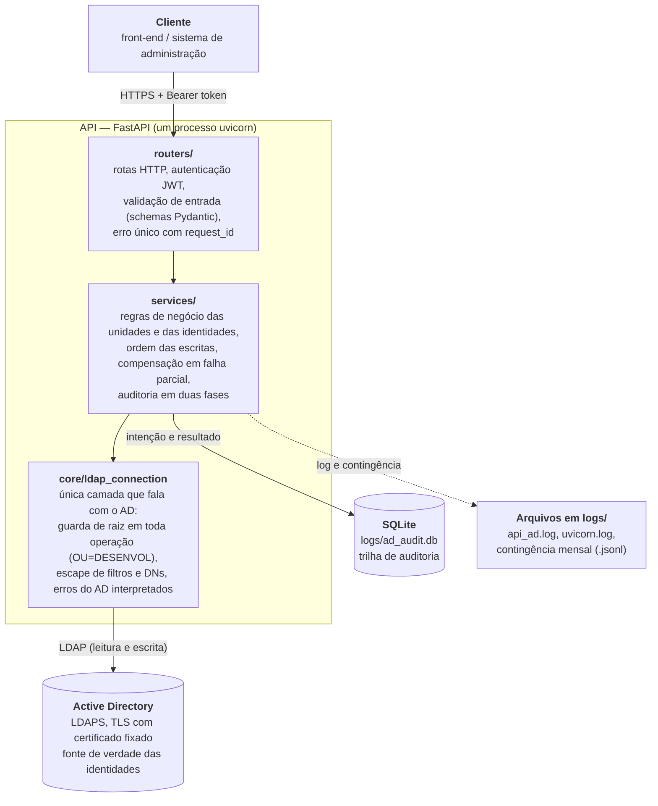

# API de Identidades no Active Directory (PML)

---

## Nome do Sistema/Módulo

API de gestão de identidades no Active Directory da Prefeitura de Londrina (versão 2.0.0).

## Propósito

A Prefeitura mantém no Active Directory (AD) as identidades de **pessoas** (humanos: servidores de carreira, comissionados e
estagiários) e de **contas técnicas** (não humanos: robôs, impressoras, serviços). A estrutura organizacional (órgãos da
Administração Direta e Indireta, empresas terceirizadas e prepostos) e a vida funcional dessas identidades (admissão,
destituição, transferência, bloqueio) precisam ser refletidas no AD de forma padronizada, auditável e segura.

Esta API é um serviço REST de **administração** do AD, chamado por um front-end/sistema de administração (não por usuários
finais). Em vez de expor LDAP, oferece **operações de nível de negócio** — "criar unidade da Administração Direta", "ativar
servidor", "destituir estagiário", "desincorporar unidade" — e cuida dos detalhes: onde cada objeto fica na árvore, bloqueio e
habilitação de contas, senha inicial, atributos de registro e trilha de auditoria.

**Proposta de valor**

- Os sistemas integrados não demandam conhececimento de LDAP ou a estrutura convencionada da árvore, ficando ao encargo da API preservar e impor o modelo.
- **Identidade nunca é excluída**: ao sair de operação é movido para o local análogo em `Inoperantes` de modo que a remoção física só
  existe para inclusão indevida ou duplicada e preservando assim "a memória" da estrutura.
- **Humanos e não humanos isolados no topo da árvore**: existe uma base LDAP apenas de identidades destinadas a humanos (`OU=Humanos,OU=Operativos,...`),
  o que simplifica os realms exclusivamente humanos no Keycloak.
- **Contenção**: nada se lê nem se escreve fora de `OU=<RAIZ>,DC=londrina,DC=pr,DC=gov,DC=br`, onde convivem objetos de produção.
- **Auditoria completa** de toda escrita, em duas fases (a intenção é gravada antes de alterações no AD), nenhuma senha exposta em log.
- Quando o AD recusa uma operação por falta de permissão ou de atributo, a API traduz o erro e diz **qual permissão pedir** à
  Infraestrutura.

## Secretaria/Órgão Gestor

Secretaria Municipal de Planejamento, Orçamento e Tecnologia

## Gestor na Secretaria/Órgão

Não há.

## Fornecedores

Diretoria de Tecnologia da Informação - DTI.

---

## Funcionalidades principais

**Estrutura (unidades/OUs), nos 4 ramos** — Direta, Indireta, Terceirizadas, Prepostos:
- criar unidade (nos dois espelhos, `Operativos` e `Inoperantes`, e nos dois lados, `Humanos` e `NaoHumanos`);
- consultar e listar unidades (paginado, por árvore); alterar o nome do órgão;
- **desincorporar** (bloqueia as contas e move a unidade para `Desincorporados`) e **reincorporar** (restaura e desbloqueia).

**Identidades humanas e não humanas:**
- criar (uma conta nasce **bloqueada e sem senha**, em `Inoperantes`), consultar e listar com filtros, alterar atributos `pml*`;
- **ativar/admitir** (define a senha inicial, move para `Operativos` e habilita), **destituir** (documenta o ato, bloqueia e move
  para `Inoperantes`), **transferir** (entre unidades, categorias e ramos) e bloquear/desbloquear no lugar;
- **redefinir a senha** (a API gera, com tamanho configurável; humano troca no próximo logon, não humano tem senha sem expiração;
  a senha é devolvida **uma única vez**);
- remover fisicamente (somente em `Inoperantes`, com motivo).

**Transversais:**
- autenticação do cliente por chave própria (`POST /auth/token`, token JWT de curta duração, limite de tentativas);
- auditoria: histórico de logins e de atividades, linha do tempo por login, resumo e relatório de segurança;
- erros em corpo único (`codigo`, `mensagem`, `detalhes`) com `request_id`; cabeçalho opcional `X-Administrador`;
- saúde (`/health` público e estático; `/health/detalhes` autenticado) e versão.

## Linguagens/Tecnologias

| Camada | Tecnologia |
|---|---|
| Linguagem | Python 3.12 |
| API REST | FastAPI, Starlette, uvicorn, Pydantic v2 e pydantic-settings |
| Active Directory | ldap3 (LDAPS; TLS 1.0 legado com certificado do DC fixado), pycryptodome |
| Autenticação | python-jose (JWT), PBKDF2-SHA256 para o segredo do cliente |
| Auditoria | SQLAlchemy 2 + SQLite |
| Testes | pytest (AD em memória); campanha de aceitação em bash + curl + jq |
| Plataforma | Active Directory, Git/GitLab, Docker e Docker Compose (imagem `python:3.12-slim`) |

## Arquitetura

### Camadas



| Camada | Responsabilidade | Não faz |
|---|---|---|
| `routers/` | Receber a requisição, autenticar, validar o formato e devolver o corpo de resposta ou o erro padronizado | Regra de negócio; falar com o AD |
| `services/` | Decidir o que fazer: checar pré-condições, executar a sequência de escritas, desfazer o que for preciso e registrar a auditoria | Chamar o `ldap3` diretamente: toda operação passa pela conexão |
| `core/ldap_connection` | Executar toda operação LDAP, validando o DN contra a raiz e transformando o erro do AD em erro de domínio | Conhecer regras de negócio |

| Pasta | Conteúdo |
|---|---|
| `app/routers/` | Rotas: `auth`, `estrutura`, `identidade`, `audit` (e `/`, `/health`, `/versao` em `main.py`) |
| `app/schemas/` | Modelos de entrada e saída (validação de nomes, logins, datas, categorias) |
| `app/services/` | `estrutura_service` (unidades), `identidade_service` (consulta, criação, alteração, bloqueio, remoção), `identidade_ciclo` (ativar, destituir, transferir, redefinir senha), `base_ad` (operações comuns) |
| `app/core/` | `arvore` (único lugar com os nomes das OUs fixas e a montagem/leitura de DNs), `raiz` (contenção), `ldap_connection`, `erros_ad`, `tls`, `atributos`, `regras`, `config`, `auth`, `limite`, `rotacao`, `logging_config` |
| `app/audit_service.py`, `app/database.py` | Auditoria em duas fases e modelos do SQLite |
| `config/` | `regras.toml` (atributos alteráveis e tipos de não humano) e `tls/` (certificado público fixado do DC) |
| `tests/`, `testes_aceitacao/` | Testes com dublês (sem AD) e campanha de aceitação contra o AD de desenvolvimento |
| `docs/` | Diagrama da árvore, especificação e relatórios dos testes de aceitação e a especificação legada |

### A árvore do AD

```
<AD_PML_BASE>  (hoje OU=PML,OU=DESENVOL,...)
 ├── Operativos        estrutura ativa
 ├── Inoperantes       espelho de Operativos: quem sai de operação vem para cá
 └── Desincorporados   unidades que deixaram o quadro (com todo o conteúdo)
        em cada uma das três:
        ├── Humanos
        │     ├── Direta ── <UNIDADE> ── Estagio | Carreira | Comissionados
        │     └── Indireta | Terceirizadas | Prepostos ── <UNIDADE>   (humanos direto na unidade)
        └── NaoHumanos
              └── Direta | Indireta | Terceirizadas | Prepostos ── <UNIDADE>   (sem categorias)
```

Diagrama: [`docs/arvore-ad.svg`](docs/arvore-ad.svg). Regras principais:

- Tudo é `organizationalUnit` (`OU=`); o nome da unidade (maiúsculas) é **único em toda a árvore**.
- A unidade existe nos dois lados (`Humanos` e `NaoHumanos`) de cada árvore; as categorias só existem em `Humanos/Direta`.
- Desativar = mover para o caminho análogo em `Inoperantes`. Desincorporar move **os dois lados** da unidade e bloqueia as
  contas; o espelho em `Inoperantes` permanece.
- A API cria os nós fixos que faltarem (`Humanos`, `NaoHumanos` e os ramos); a OU de cada árvore tem de existir.
- Não há remoção de OU.

### Contenção e segurança

- **Raiz constante** (`app/core/raiz.py`): `OU=DESENVOL,...` está no código, não na configuração. Toda operação LDAP (leitura ou
  escrita) tem o DN validado por componentes RDN, com origem e destino em mudanças de DN; base de busca vazia é recusada.
- **Sem rootDSE nem schema**: a conexão não os lê; a existência de atributos é descoberta pelo erro do AD.
- **Escape** de filtros LDAP e de RDN em todo valor vindo do cliente; nenhuma rota aceita DN.
- **TLS obrigatório**: o controlador atual só fala TLS 1.0 (RSA 1024, SHA-1); a limitação foi aceita e o
  certificado do DC é **fixado** (`config/tls/cegonha.pem`), conferido antes de qualquer credencial.
- **Cliente único** autenticado por chave própria; sem papéis finos na v1. O administrador humano pode ser
  informado em `X-Administrador` e é registrado **sem verificação**.
- Senhas: geradas pela API, devolvidas uma única vez com `Cache-Control: no-store`, **nunca** em log nem auditoria.

### Dados e auditoria

- **AD**: fonte de verdade das identidades e da estrutura.
- **SQLite** (`logs/ad_audit.db`): trilha de auditoria. Cada escrita no AD é auditada em **duas fases**: a
  intenção (`INICIADA`) é gravada antes; se não puder ser gravada, a operação **não ocorre**; o resultado (`SUCCESS`, `FAILED`
  ou `INCONSISTENTE`) é gravado depois, e se isso falhar o fato vai para um arquivo de contingência.
- **Operações compostas** têm pré-validação, compensação em falha parcial e marca `INCONSISTENTE` quando a compensação também falha.
- **Atributos de registro `pml*`** (instrumento e data dos atos, CPF, tipo de não humano): ainda **não existem no schema do AD**;
  a extensão é pedida à Infraestrutura. Enquanto isso as operações que os gravam falham com
  `AD_SCHEMA_INCOMPLETO` — ou, só em desenvolvimento, `PML_GRAVAR=false` pula a gravação e avisa na resposta.

## Documentação

### Pré-requisitos e instalação

Python 3.12, acesso de rede ao controlador de domínio e uma conta de serviço do AD com as permissões necessárias (cada erro `AD_PERMISSAO_NEGADA` indica a permissão a pedir à Infraestrutura).

```bash
git clone https://gitlab.londrina.pr.gov.br/GRDS-1/estagio-id/pml-api-active-directory.git
cd pml-api-active-directory
python -m venv .venv
source .venv/bin/activate      # Linux/WSL  (Windows: .venv/Scripts/activate)
python -m pip install -r requirements.txt
```

### Configuração (`.env`)

Copie `.env.example` para `.env` e preencha (o arquivo nunca é versionado). A lista completa e os comentários estão em
`.env.example`. As principais:

| Chave | Para que serve |
|---|---|
| `JWT_SECRET_KEY`, `API_CLIENT_ID`, `API_CLIENT_SECRET_HASH` | **Obrigatórias**: a API não sobe sem elas. O `.env.example` mostra como gerar o hash do segredo do cliente |
| `AD_SERVER`, `AD_BIND_USER`, `AD_BIND_PASSWORD`, `AD_UPN_SUFIXO` | Conexão e conta de serviço da API no AD (segredos só no `.env`) |
| `AD_PML_BASE` | Raiz da sub-árvore da API; tem de estar dentro de `OU=DESENVOL,DC=londrina,DC=pr,DC=gov,DC=br`, senão a API não sobe |
| `AD_TLS_LEGADO`, `AD_TLS_CERT_FIXADO`, `AD_TLS_CA_FILE` | TLS: `ldaps://`, TLS 1.0 do DC atual e certificado fixado (`config/tls/cegonha.pem`) |
| `AD_ALLOW_INSECURE` | Só desenvolvimento, enquanto o DC recusar TLS; proibido com `AMBIENTE=prod` |
| `AMBIENTE` | `dev` ou `prod`; `prod` proíbe `AD_ALLOW_INSECURE` e `PML_GRAVAR=false` |
| `PML_GRAVAR` | Temporária: `false` pula a gravação dos `pml*` enquanto o schema não existe |
| `API_REGRAS_FILE` | Atributos alteráveis por `PATCH` e tipos de não humano (padrão `config/regras.toml`) |
| `LOG_DIR`, `LOG_MAX_BYTES`, `API_LOG_FILE`, `DATABASE_URL`, `AUDITORIA_CONTINGENCIA_FILE` | Logs e auditoria; padrão tudo em `logs/` |
| `CORS_ALLOW_ORIGINS`, `JWT_ACCESS_TOKEN_EXPIRE_MINUTES`, `AUTH_MAX_FALHAS`, `AUTH_JANELA_SEGUNDOS` | CORS, validade do token e limite de falhas em `/auth/token` |

### Executar e testar

```bash
python -m uvicorn app.main:app --reload     # http://localhost:8000/docs  (Swagger)
python -m pytest -q                          # testes com AD em memória: nenhum acesso ao AD
python -m pytest -m integration              # opt-in: handshake TLS real com o DC, sem bind
```

### Execução em container (Docker Compose)

A imagem é `python:3.12-slim` (Debian, não alpine: as dependências de criptografia têm *wheels* para ela e instalam sem
compilador) com o código dentro; **configuração, logs e `.env` ficam no host**.

```bash
cp .env.example .env                    # preencha; o arquivo nunca vai para a imagem nem para o Git
mkdir -p logs && chown "$(id -u):$(id -g)" logs   # a pasta de logs precisa ser gravável pelo API_UID/API_GID
docker compose up -d --build            # http://127.0.0.1:8000/docs
docker compose logs -f api              # cópia do console; os arquivos completos estão em logs/
docker compose down                     # para (logs/ e auditoria permanecem no host)
docker compose run --rm testes          # pytest dentro da imagem (AD em memória)
```

| Volume / entrada | No host (padrão) | No container | Observação |
|---|---|---|---|
| Configuração | `./config` (`API_CONFIG_DIR`) | `/app/config` (somente leitura) | `regras.toml` e o certificado fixado do DC (`tls/cegonha.pem`) |
| Logs e auditoria | `./logs` (`API_LOGS_DIR`) | `/app/logs` | `api_ad*.log`, `uvicorn.log`, `ad_audit.db`, contingência; política de quebra sem apagar |
| Ambiente | `.env` (`API_ENV_FILE`) | `/app/.env` (somente leitura) | lido pela própria API, como fora do container; o Compose não o injeta (interpolaria o `$` do hash do segredo e o corromperia) |

**Podman** (alternativa ao Docker, sem daemon próprio): os mesmos arquivos servem. No Windows, inicie a máquina uma vez
(`podman machine start`) e use `podman compose up -d --build` no lugar de `docker compose ...` (o `podman compose` delega
ao `docker-compose` instalado). A base é referenciada por nome completo (`docker.io/library/python:3.12-slim`), o que evita o
aviso de *short-name* do Podman. Em Podman **rootless** o uid do container não é o do host: use `API_UID=0` (o root do
container é o seu usuário) ou `userns_mode: "keep-id"`; na máquina **rootful** do Windows e no Docker o padrão `1000` funciona.

Variáveis do Compose (todas opcionais; lista comentada no fim do `.env.example`): `API_BIND` e `API_PORT` (a porta só é publicada
em `127.0.0.1` por padrão; o HTTPS é do proxy reverso), `API_UID`/`API_GID` (dono dos arquivos de log), `API_ENV_FILE`,
`API_CONFIG_DIR`, `API_LOGS_DIR`, `API_IMAGE_TAG`, `TZ` (o log vira por dia local) e `FORWARDED_ALLOW_IPS`. Exemplos:

```bash
API_ENV_FILE=prod.env API_LOGS_DIR=/var/log/pml-api docker compose up -d     # outro .env e outra pasta de logs
API_BIND=0.0.0.0 API_PORT=8080 docker compose up -d                           # abrir à rede (atrás de um proxy)
```

Pontos de atenção:
- No container, deixe `LOG_DIR`, `API_LOG_FILE`, `DATABASE_URL` e `AUDITORIA_CONTINGENCIA_FILE` **vazios** no `.env` (caminhos do host não valem lá dentro).
- **IP do cliente** (auditoria e limite de login): com o mapeamento de porta do Docker, o `uvicorn` vê o IP do gateway da rede do
  Docker. Com um proxy reverso no host, ajuste `FORWARDED_ALLOW_IPS` para o IP que o container enxerga (e só com a API em loopback).
- **SQLite** em volume exige disco local (ext4/WSL2); em NFS/SMB o bloqueio de arquivo não é confiável.
- **Um container, um processo**: a rotação de logs vale para um único `uvicorn`; não use `--workers` nem réplicas.
- O `json-file` do Docker limita só a cópia do console (`max-size`); os arquivos de `logs/` não são apagados.
- **TLS 1.0 com o DC na imagem Debian**: o handshake foi verificado na imagem (Podman) e funciona sem ajuste. Para repetir:
  `docker compose run --rm testes python -m pytest -m integration tests/test_tls_dc.py`. Se um dia falhar (imagem base nova com
  política mais estrita), descomente `OPENSSL_CONF` no `docker-compose.yml`
  (usa o `config/openssl-legado.cnf`, com `MinProtocol = TLSv1` e `CipherString = ALL:@SECLEVEL=0`); vale só para o serviço da API, restrita ao canal com o AD.

### Endpoints

Todas as rotas, exceto `/`, `/health` e `/auth/token`, exigem `Authorization: Bearer <token>`. O contrato completo (corpos, regras e códigos de erro) está no Swagger (`/docs`).

| Prefixo | O que faz |
|---|---|
| `POST /auth/token` | Emite o token do cliente (`client_id` e segredo no corpo) |
| `/estrutura/unidades/{ramo}` | Listar e criar unidades; `/{nome}`: consultar, alterar, `desincorporar`, `reincorporar` |
| `/identidade/humanos` e `/identidade/naohumanos` | Listar e criar; `/{login}`: consultar, alterar (`PATCH`), `bloquear`, `desbloquear`, `ativar`, `destituir`, `transferir`, `redefinir-senha`, remover (`DELETE`) |
| `/auditoria/...` | `login-history`, `activity-history`, `historico/{login}`, `user-summary/{username}`, `security-report` |
| `/`, `/health`, `/health/detalhes`, `/versao` | Status; `/health` é público e não toca no AD |

`{ramo}` ∈ `direta`, `indireta`, `terceirizada`, `preposto`.

### Logs e auditoria

Tudo fica em `logs/` (chave `LOG_DIR`; fora do Git) e **nada é apagado**:

| Arquivo | O que é |
|---|---|
| `logs/api_ad.log` | Log da aplicação (corrente). Vira ao mudar o dia ou ao passar de `LOG_MAX_BYTES` (50 MB) para `api_ad-AAAA-MM-DD.NNN.log` |
| `logs/uvicorn.log` | Acessos e erros do servidor, com a mesma política |
| `logs/ad_audit.db` | Trilha de auditoria (SQLite); a API nunca apaga linhas |
| `logs/auditoria_contingencia-AAAA-MM.jsonl` | Fatos que não puderam ser gravados no banco depois de o AD mudar (um arquivo por mês) |
| `logs/teste/` | Escrita dos testes automáticos |

Compactar ou arquivar o que já virou é rotina operacional, fora da API. Para o `ad_audit.db`, copie periodicamente com
`sqlite3 ad_audit.db ".backup 'destino.db'"` para fora do diretório de trabalho. Cada falha do AD vira uma linha `AD_ERRO ...`
no log, com o código LDAP e a permissão provável a solicitar; cole essa linha para interpretação.

### Auditoria e LGPD

Toda ação de escrita fica registrada: quem (cliente e, se informado, o administrador), o quê, quando, de onde e se deu certo.
Senhas nunca são auditadas nem registradas em log. O CPF é um campo comum e pode constar da auditoria.

### Campanha de aceitação (AD real)

`testes_aceitacao/` executa, com `curl`, todas as rotas contra a API em `127.0.0.1:8000`, que fala com o AD de desenvolvimento
(10 unidades e 72 contas, mantidas ao final). Cada fase (F0 a F9) roda **só com autorização do responsável**; a especificação e
os resultados estão em [`docs/testes/`](docs/testes/). Antes de uma campanha nova, o conteúdo antigo das três árvores sob
`OU=PML` precisa estar limpo. Detalhes em [`testes_aceitacao/README.md`](testes_aceitacao/README.md).

### Documentos do projeto

| Documento | Para que serve |
|---|---|
| [`docs/arvore-ad.svg`](docs/arvore-ad.svg) | Diagrama da árvore do AD |
| [`docs/testes/`](docs/testes/) | Especificação e resultados dos testes de aceitação |
| [`docs/legado/`](docs/legado/) | Especificação antiga (não vigente) |

### Problemas conhecidos

- **Canal com o DC fraco** — TLS 1.0, RSA 1024, SHA-1; limitação aceita. O certificado fixado vence em
  **20/09/2027**: ao renovar, substituir `config/tls/cegonha.pem`.
- **Atributos `pml*` ainda não existem no schema** — ver "Dados e auditoria".
- **`scripts/criar_estrutura_ad.py` é legado**: cria a árvore anterior à separação entre Humanos e NaoHumanos e não deve ser usado; a API cria sozinha os
  nós fixos. Reescrevê-lo ou removê-lo é decisão pendente. `scripts/listar_ous.py` (só leitura da `AD_PML_BASE`) continua válido.
- **Limite de login em memória**: o limite de falhas em `/auth/token` vale por processo.
- **Rotação de logs para um processo**: com vários workers do uvicorn seria preciso um rotador externo.

### Troubleshooting rápido

| Sintoma | Causa provável |
|---|---|
| `ValueError: unsupported hash type MD4` | falta `pycryptodome` (está no `requirements.txt`) |
| A API não sobe, `Field required` | faltam `JWT_SECRET_KEY`, `API_CLIENT_ID` ou `API_CLIENT_SECRET_HASH` no `.env` |
| A API não sobe, "fora de OU=DESENVOL" | `AD_PML_BASE` fora da raiz permitida |
| `AD_TLS_INDISPONIVEL` | o DC recusou o TLS (veja `AD_TLS_LEGADO` e `AD_SERVER=ldaps://...`) |
| `AD_CERTIFICADO_NAO_CONFERE` | o DC apresentou outro certificado que o fixado em `AD_TLS_CERT_FIXADO` (renovado?) |
| `AD_PERMISSAO_NEGADA` | falta permissão à conta da API; use a linha `AD_ERRO` do log para pedir à Infraestrutura |
| `AD_SCHEMA_INCOMPLETO` | atributo `pml*` ausente no schema (a Infraestrutura precisa estender o schema) |
| `NAO_ENCONTRADO` (noSuchObject) | `.env` errado, `AD_PML_BASE` incorreto ou a unidade não existe |
| API não reflete mudança / "Failed to fetch" | processo antigo do uvicorn ainda rodando; encerre-o e suba de novo |
| Container: `permission denied` em `/app/logs` | a pasta `logs/` do host não é gravável por `API_UID:API_GID` (veja `id -u` e `chown`) |
| Container não sobe ou `.env` virou pasta | o `.env` (ou o arquivo de `API_ENV_FILE`) tem de existir **antes** do `up` (`cp .env.example .env`); no Docker, montar um arquivo inexistente cria uma pasta com esse nome |
| Aviso do Compose `variable "..." is not set` | o `.env` tem um `$` (hash do segredo); é só o Compose lendo o arquivo para interpolar e não afeta a API, que lê o arquivo sozinha. Entre aspas simples o aviso some |
| Container: porta em uso | outro processo (a API local?) já usa `127.0.0.1:8000`; pare-o ou mude `API_PORT` |
| Container `unhealthy` | `docker compose logs api`: `.env` incompleto (`Field required`) ou `AD_PML_BASE` inválido |
| Pylance sublinhando imports | interpretador errado no VS Code — `Ctrl+Shift+P` → Select Interpreter |

### Fluxo de trabalho (Git)

`origin` é o GitLab oficial e a `main` é protegida: trabalhe em uma branch e abra Merge Request. Todo comportamento novo vem com
teste com dublê; executar testes ou tocar o AD só com autorização do responsável (regras do projeto: nada fora de `OU=DESENVOL` e permissões do AD descobertas por uso).

## Implantação

* acessodev.londrina.pr.gov.br (testes)
* acesso.londrina.pr.gov.br (produção)

A API foi validada contra o AD de desenvolvimento (`OU=DESENVOL`). Antes de produção: extensão do schema com os atributos `pml*`
(Infraestrutura), `AMBIENTE=prod` com `PML_GRAVAR=true`, entrega do segredo do cliente ao front-end, HTTPS entre o front-end e a
API e atualização do certificado fixado quando o do DC for renovado.

## Autores

* **Ricardo Faggion** — Analista de Sistemas - Prefeitura de Londrina (concepção, arquitetura, revisão de código e commits evolutivos)
* **Yasmin Fernanda de Carvalho** — Estagiária (Unicesumar) na Prefeitura de Londrina (contribuições no repositório)
* **Augusto Henrique Carreiro Zardo** — Estagiário (UFPG) na Prefeitura de Londrina (contribuições no repositório)
